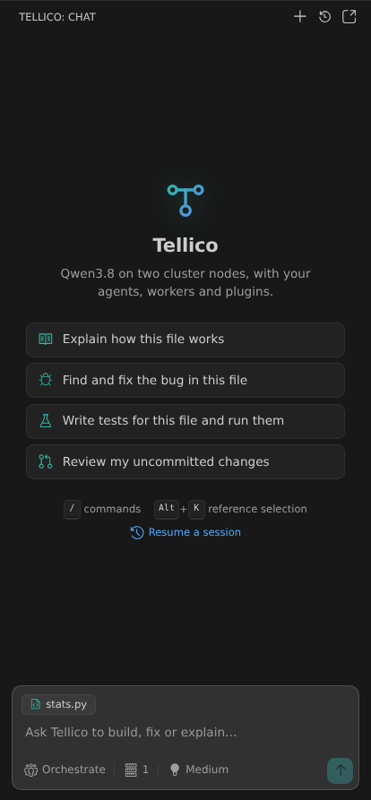
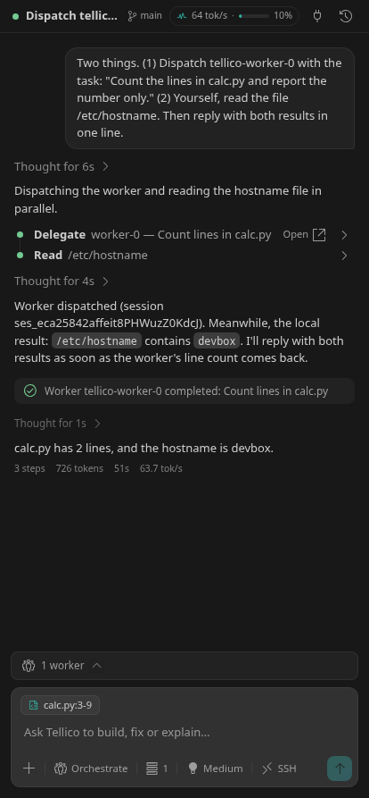

# Tellico for VS Code

A chat sidebar for the Tellico Qwen setup: the same agents, plugins, workers
and Magic Context as `opencode-tellico`, in VS Code instead of a terminal.

<p align="center">
  
  &nbsp;
  
</p>

- **Streaming chat** in the sidebar or in editor tabs (`Ctrl+Shift+Esc`),
  paced like a chat app so text flows steadily over SSH or the gateway, with
  collapsible reasoning and a card per tool call. Tabs come back after a
  window reload.
- **Checkpoints**: hover a message you sent to **rewind** the files and the
  conversation to before it (Redo until you send again), **edit and resend**
  it, or **fork** a new session from there.
- **Queue or steer while it works**: `Enter` queues a follow-up for after
  the turn, `Ctrl+Enter` steers the running turn at its next step. Queued
  prompts sit above the input with *Steer now* and remove.
- **Knows what it is waiting on**: the phase line says whether the turn
  waits for the model (prefill on a cold prompt is slow on a local
  cluster), runs a tool, retries (with a countdown), or compacts; a context
  meter shows the window filling, with *Compact now*.
- **build / orchestrate**, **node 0 / 1** and **thinking level** pickers, the
  same choices as `opencode-tellico [0|1] [--orchestrate] [--think LEVEL]`.
- **Workers panel**: every subagent the lead dispatches, with live status;
  click one to read its transcript, stop one that runs away. A worker's
  permission requests show up in the lead's view.
- **Changed files**: per session, including workers' edits, with VS Code's own
  diff editor and a one-click revert.
- **Context in**: `@` completes files (`@file#L3-9` for lines), the active
  file and selection are attached (toggle the chip), `Alt+K` inserts a
  reference, files dropped from the Explorer become references, `!cmd` runs
  a shell command with no model turn, and terminal output or the last
  terminal command goes to the chat from the terminal's context menu.
- **Fix with Tellico** and **Explain with Tellico** in the lightbulb menu.
- **MCP**: a Tools panel with OpenCode's MCP servers (status, errors,
  on/off, OAuth sign-in), adding servers or importing VS Code's `mcp.json`,
  and a built-in `vscode` server that lets the agent ask VS Code for
  diagnostics, open editors and the selection. See [MCP](#mcp).
- **Slash commands** from the server, including Magic Context's `/ctx-*`,
  MCP prompts, and `/think-off|low|medium|xhigh`.
- **Permission and question cards** when an agent asks; the saved
  *always allow* rules are listed in the Tools panel and can be removed.
- **Tells you when it needs you**: a badge on the Tellico icon and the status
  bar while a question waits, and a notification when a turn ends or asks
  while VS Code is in the background. Screen readers hear both.
- **History**: resume, rename or pin any session, including ones started in
  the terminal; busy and unread sessions are marked. Sessions live in
  OpenCode's own store, so both see the same list, and each keeps its own
  draft.

## How it works

The extension does not reimplement anything. It starts
`opencode-tellico serve` for the open folder (one private OpenCode 2 server
per window, on a random loopback port, with a random password), and talks to
its HTTP API and event stream. Everything Tellico-specific -- the lead node,
agents, prompts, plugins, Magic Context, the tunnel or gateway -- comes from
the installed [tellico-agentic-setup] client, so the terminal and VS Code
cannot drift apart.

```
VS Code ──HTTP+SSE──▶ opencode-tellico serve ──▶ Tellico (tunnel or gateway)
```

## Requirements

- **OpenCode 2** (`opencode --version` ≥ 2.0). OpenCode 1's server API is
  different and not supported yet.
- **The Tellico client**, installed from [tellico-agentic-setup] *after*
  `opencode-tellico serve` was added:
  - with a cluster account: `./install.sh`
  - with only an API key: `./install.sh --gateway` and paste the key
- Linux, macOS, WSL or a Remote-SSH host (the launcher is POSIX sh). The
  extension runs on the machine where the code and the client are; under
  Remote-SSH, install it on the remote side.

Check the client with `./doctor.sh` in the tellico-agentic-setup checkout.

## Install

Download the `.vsix` from the [releases] page, then:

```sh
code --install-extension tellico-vscode-<version>.vsix
```

Open a folder, click the Tellico icon in the activity bar, and type.

## Settings

| Setting | Default | |
|---|---|---|
| `tellico.launcherPath` | `opencode-tellico` | Found on `PATH` or in `~/.local/bin`. |
| `tellico.connection` | `installed` | `tunnel` (SSH), `gateway` (API key) or whatever `./install.sh` set up. |
| `tellico.gatewayUrl` | empty | Gateway base URL; empty uses the one `./install.sh` recorded. |
| `tellico.leadNode` | `auto` | `auto` derives a stable node from this device, like the launcher. |
| `tellico.defaultMode` | `build` | `orchestrate` lets the lead delegate to the two workers. |
| `tellico.defaultThink` | `medium` | Starting thinking level for new sessions. |
| `tellico.magicContext` | `true` | Off = `--no-magic-context`. |
| `tellico.backgroundSubagents` | `false` | Dispatch workers in the background. Off by default, like the launcher. |
| `tellico.attachActiveEditor` | `true` | Attach the active file to each message. |
| `tellico.showReasoning` | `false` | Expand reasoning blocks by default. |
| `tellico.smoothStreaming` | `true` | Pace streamed text steadily instead of showing token clusters as they land. |
| `tellico.ideTools` | `true` | The built-in `vscode` MCP server (diagnostics, open editors, selection). |
| `tellico.codeActions` | `true` | *Fix with Tellico* / *Explain with Tellico* in the lightbulb menu. |
| `tellico.notifications` | `unfocused` | Notify when a turn ends or Tellico asks: `unfocused`, `always` or `off`. |
| `tellico.websearch` | `default` | Web search provider (`TELLICO_WEBSEARCH`): tavily, exa, parallel, random or off. |
| `tellico.steps` | `0` | Max steps per turn for the leads (`TELLICO_STEPS`); 0 keeps the launcher's 200. |
| `tellico.loopGuard` | `true` | Off = `TELLICO_LOOP_GUARD=0`. |
| `tellico.remoteControl` | `installed` | Phone remote control for this window's sessions: `on`, `off`, or as installed. |

Changing a server setting offers to restart the server.

## SSH or API key

Pick how the models are reached from the plug icon in the chat box, the
**Tellico: Switch Connection** command, or `tellico.connection`; the status
bar shows which is in use (`· SSH` / `· gateway`). Switching restarts the
server, and sessions carry over.

- **SSH tunnel** uses your cluster account, exactly like a tunnel-mode
  install: the launcher brings the tunnel up and fetches the cluster key.
- **API gateway** uses a per-user key and no SSH. The first time, the
  extension asks for the key (**Tellico: Set Gateway API Key** changes it
  later) and stores it in `~/.config/tellico-qwen` with mode 600 -- the
  same place the launcher and `./install.sh --gateway` keep keys, guarded by
  the same secret guards. It is never put in VS Code settings.

Each connection keeps its own key file, so switching never overwrites the
other one. Under the hood this is `opencode-tellico --connection
tunnel|gateway`, which needs a tellico-agentic-setup install from after that
flag was added (`./install.sh --no-start` updates one).

## Keys

| Key | |
|---|---|
| `Ctrl+Esc` | Focus the chat |
| `Ctrl+Shift+Esc` | Open a chat in a new editor tab |
| `Alt+K` | Reference the selection in the composer |
| `Enter` / `Shift+Enter` | Send / newline |
| `Enter` while busy | Queue for after the turn |
| `Ctrl+Enter` while busy | Steer the running turn now |
| `↑` in an empty input | Recall your last message |
| `@` / `!` / `/` | Files / shell command / slash commands |
| `Esc` | Stop the running turn (`Ctrl+Alt+Esc` from anywhere) |

## MCP

Open **Tools** (the plug in the chat header, or *Tellico: MCP Servers*).

- **The `vscode` server** is the extension's own: a loopback-only MCP
  server with a per-window token, registered with the running OpenCode
  server at startup and never written to any file. It gives the agent
  three tools (`vscode_diagnostics`, `vscode_open_editors`,
  `vscode_selection`), so it can check what the language servers say
  after an edit instead of guessing. Turn it off with `tellico.ideTools`.
- **Add server…** first lists the MCP servers already on this machine:
  ones configured in Claude Code, Claude Desktop, Cursor, VS Code, Cline,
  Roo, Windsurf, Gemini CLI, Codex, Crush or Zed; installed `*-mcp`
  commands; and servers you built (Node packages on the MCP SDK with a
  built `bin`, under `~/Documents/repos`, `~/code` and the like, plus
  `tellico.mcpSearchPaths`). It can add one switched off. Environment values
  found in another client's config are written as `{env:NAME}` references
  unless you choose to copy them into your global config; they are never
  copied into a project file.
- **Config check**: OpenCode 2 silently misreads some entries under
  `mcp.servers` -- `"enabled": false` (the server starts anyway), `args` and
  `env` (ignored), a string `command` or `"type": "stdio"` (the server is
  dropped). The Tools panel flags them and **Fix** rewrites them.
- **Your servers** come from OpenCode's own config, which Tellico sessions
  load under the Tellico runtime config: an `mcp` block in the project's
  `opencode.json` or in `~/.config/opencode/opencode.json`. **Add server…**
  writes there the way `opencode mcp add` does; **Import from VS Code…**
  copies servers from `.vscode/mcp.json` or your user `mcp.json`, turning
  `${env:X}` into OpenCode's `{env:X}` so tokens stay in the environment.
  The server applies edits within seconds; no restart.
- Servers that need OAuth show **Sign in**, which opens the browser.
  The switch turns a server off until the server restarts.

Keep the list short: every MCP tool's description is sent with **every**
request, against Tellico's 131k-token context, and Tellico's secret-guard
does not inspect MCP tools (workers allow every tool).

## Troubleshooting

- **"The installed opencode-tellico predates serve mode"**: run
  `./install.sh --no-start` in tellico-agentic-setup.
- **Server fails to start**: *Tellico: Show Server Logs* shows the launcher's
  own output (tunnel, gateway and config errors appear there first).
- **First token takes a long time**: a prompt the server has not cached is
  prefilled at about 1500 tokens/s, so a 100k-token conversation waits over
  a minute; returning to a session is fast again. The four request slots
  are shared, so a busy cluster queues you (the gateway retries and says so).
- **An agent is stuck or looping**: `Esc` stops it; hover the message you
  sent and **rewind** to try again from a clean state.
- **Thinking level seems to have no effect**: update the client
  (`./install.sh --no-start` in tellico-agentic-setup); installs from before
  2026-10-13 lose it on OpenCode 2.

## Known limitations

- One server per window, for the first workspace folder.
- The Tellico model reads text only, so images cannot be attached.
- MCP servers switched off from the Tools panel come back when the server
  restarts; edit the config (or set `disabled`) to turn one off for good.

## Development

```sh
npm install
npm run build          # or: npm run watch
npm test               # unit tests from recorded server events, plus a plain
                       # `opencode serve` integration test when opencode is installed
npm run typecheck
npm run preview        # the webview in a browser, fed by the fixtures
npm run preview -- --shot --both   # headless screenshots of every scene
npm run test:vscode    # activate in a throwaway VS Code window
```

Press `F5` in VS Code to launch an Extension Development Host. The live
end-to-end test uses a real cluster slot and is skipped unless asked for:

```sh
npm run test:live      # TELLICO_LIVE=1; TELLICO_LIVE_CONNECTION=tunnel|gateway
```

`npm run package` builds `tellico-vscode-<version>.vsix`. Tag `vX.Y.Z` to
have CI attach it to a GitHub release.

[tellico-agentic-setup]: https://github.com/Yejashi/tellico-agentic-setup
[releases]: https://github.com/Yejashi/tellico-vscode/releases
